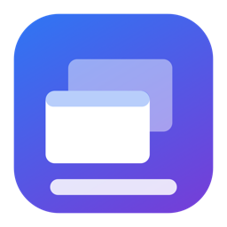

<p align="center">
  
</p>

<h1 align="center">DockPeek</h1>

<p align="center">
  Windows 11 style taskbar previews for the macOS Dock.<br>
  Rest the mouse on a running app's Dock icon and see live thumbnails of all its windows.
</p>

---

DockPeek is a small menu-bar app (it has no Dock icon of its own) written in Swift with AppKit and
ScreenCaptureKit. It adds the behaviour of the Windows 11 taskbar thumbnail flyout to the Dock:
hover to preview, click to jump to a window, close windows right from the preview.

## Contents

- [Features](#features)
- [Requirements and permissions](#requirements-and-permissions)
- [Install](#install)
- [Using DockPeek](#using-dockpeek)
- [Quit apps when their last window closes](#quit-apps-when-their-last-window-closes)
- [Settings and where they are stored](#settings-and-where-they-are-stored)
- [How it works](#how-it-works)
- [Resource use](#resource-use)
- [Limitations](#limitations)
- [Troubleshooting](#troubleshooting)
- [Project layout](#project-layout)
- [License](#license)

## Features

| | |
| --- | --- |
| **Hover previews** | After about 0.35 s on a Dock icon a blurred panel opens next to it (above a bottom Dock, beside a left or right one). One card per window: app icon, title and thumbnail. |
| **Live thumbnails** | While the panel is open, thumbnails refresh about twice a second, so video and typing show up. Titles update too, and the panel notices windows opening and closing. |
| **Click to raise** | Click a card to bring that window to the front. Minimized windows are restored. |
| **Close from the preview** | An **x** appears on the hovered card. Middle-click closes the window too. |
| **Peek** | Rest on a card for about 0.45 s and the screen dims and shows that window at full size in its real position, above whatever covers it (an approximation of Windows' Aero Peek). Click-through, so nothing is blocked. |
| **List layout** | With more than 8 windows, or when the cards would not fit the screen, the panel becomes a vertical list of icon, title and **x**. |
| **Minimized badge** | Minimized windows are dimmed and labelled "Minimized". |
| **Keyboard control** | While the panel is open: arrows move the highlight, Return raises, Delete or Cmd+W closes, Esc dismisses. |
| **Per-app quit** | Optionally quit an app when its last window is closed from the preview, chosen per app. |
| **Launch at Login** | Toggle from the menu-bar icon. |

## Requirements and permissions

- macOS 14 (Sonoma) or later
- Xcode command line tools with Swift 5.9 or later (to build)

DockPeek needs two permissions, both in **System Settings, Privacy & Security**:

| Permission | Used for | Without it |
| --- | --- | --- |
| **Accessibility** | Finding which Dock icon is under the mouse, raising and closing windows, keyboard control | The app does nothing |
| **Screen & System Audio Recording** | Window thumbnails and peek | You get a title list without thumbnails |

macOS only applies a new Screen Recording grant after the app restarts.

## Install

```bash
git clone https://github.com/kalderonski73/DockPeek.git
cd DockPeek
./build.sh
cp -R DockPeek.app /Applications/
open /Applications/DockPeek.app
```

Then grant the two permissions, quit DockPeek from its menu-bar icon, and open it again.
Turn on **Launch at Login** from the menu-bar menu while running the copy in `/Applications`.

### Code signing, and why permissions can reset

macOS ties permissions to the app's code signature. An ad-hoc signature changes on every build, so
macOS would ask again after each rebuild. `build.sh` therefore signs with a certificate named
**DockPeek Local Signing** if it finds one in your login keychain, and falls back to ad-hoc otherwise.

To create a stable local certificate once:

```bash
cat > cs.cnf <<'CNF'
[req]
distinguished_name=dn
x509_extensions=ext
prompt=no
[dn]
CN=DockPeek Local Signing
[ext]
basicConstraints=critical,CA:false
keyUsage=critical,digitalSignature
extendedKeyUsage=critical,codeSigning
CNF
openssl req -x509 -newkey rsa:2048 -nodes -days 3650 -config cs.cnf -keyout k.pem -out c.pem
openssl pkcs12 -export -inkey k.pem -in c.pem -out c.p12 -passout pass:dp -legacy
security import c.p12 -k ~/Library/Keychains/login.keychain-db -P dp -T /usr/bin/codesign
rm -f cs.cnf k.pem c.pem c.p12
```

The app is not notarized, so it is meant to be built locally rather than downloaded.

## Using DockPeek

**Mouse**

1. Rest the pointer on a running app's Dock icon. The preview panel opens.
2. Move onto the panel. It stays open while the pointer is over it.
3. Click a card to raise that window, click the **x** (or middle-click) to close it, or right-click for the per-app menu.
4. Move away and the panel closes after about 0.3 s.

**Keyboard** (panel open)

| Key | Action |
| --- | --- |
| Left / Right or Up / Down | Move the highlight, wrapping at the ends. Peek follows it |
| Return | Raise the highlighted window and close the panel |
| Delete or Cmd+W | Close the highlighted window |
| Esc | Dismiss the panel. It will not reopen until the pointer leaves that icon |

The mouse and keyboard share one highlight. After using the keyboard, the panel stays open until the
pointer moves away. While the panel is open these keys are handled by DockPeek and do not reach the
app underneath; keys pressed with Cmd, Ctrl, Option or Shift pass through (except Cmd+W).

**Menu-bar menu**

- Open Accessibility Settings / Open Screen Recording Settings
- Quit Apps When Closing Their Last Window (default)
- Reset Per-App Choices
- Launch at Login
- Quit DockPeek

## Quit apps when their last window closes

Some apps should disappear when you close their last window (Music, Word), others should keep
running (Docker). DockPeek lets you choose per app.

- **Per app:** right-click a card and tick **Quit <App> When Closing Its Last Window**. Choose
  **Use Default for <App>** to remove your choice.
- **Default:** the menu-bar item **Quit Apps When Closing Their Last Window (default)** applies to
  every app without its own choice. It is off by default.
- **Reset Per-App Choices** clears all per-app choices.

Details: it applies when you close a window from the preview (x, middle-click, Delete or Cmd+W).
It waits until the window is really gone, so a "Save changes?" sheet is respected, and it uses a
normal quit (not a force-quit) so apps can still ask to save. Finder is never quit.
The right-click menu also has **Close Window** and **Quit <App> Now**.

## Settings and where they are stored

Settings are standard macOS preferences for `com.k1000o.DockPeek`. They survive restarts, reboots,
rebuilds and reinstalls.

| Key | Meaning |
| --- | --- |
| `quitOnLastClose` | Default for apps without their own choice |
| `quitOverrides` | Per-app choices, bundle id to on/off |

```bash
defaults read com.k1000o.DockPeek     # inspect
defaults delete com.k1000o.DockPeek   # reset everything
```

Launch at Login is stored by macOS itself. A small diagnostic log is written to
`~/Library/Logs/DockPeek.log`.

## How it works

1. **Finding the hovered icon.** A global mouse-move monitor (no polling) wakes the app only when
   the pointer is near a screen edge or a panel is open. It then asks the Dock process, through the
   Accessibility API, which element is under the pointer. An application Dock item gives the app's
   bundle URL, which is matched to a running app.
2. **Listing windows.** ScreenCaptureKit lists the app's windows. The list is filtered through the
   app's Accessibility windows, because browsers keep invisible helper windows that otherwise show up
   as blank cards. Minimized state comes from Accessibility.
3. **Thumbnails.** Each window is captured with `SCScreenshotManager` at a small size, in parallel.
   While the panel is open, a 0.5 s timer re-captures and updates the cards in place; the layout is only
   rebuilt when the set of windows changes.
4. **The panel.** A non-activating, borderless `NSPanel` at pop-up level, so it never steals focus.
   Its position follows whichever screen edge the Dock icon is nearest to.
5. **Peek.** A click-through full-screen panel just below the Dock's window level dims the screen
   and draws a full-size capture of the hovered window at its own frame.
6. **Keyboard.** A `CGEventTap` exists only while the panel is open, so it can swallow the keys it
   uses without taking focus. It is removed as soon as the panel closes.
7. **Raise and close.** Raising sets the window's Accessibility attributes (un-minimize, raise, main)
   and activates the app. Closing presses the window's Accessibility close button.

## Resource use

Idle, DockPeek uses about 0.0% CPU and roughly 50 MB of memory, since nothing runs until the pointer
moves near a screen edge. While a panel is open it captures the app's windows twice a second, which
costs more for apps with many windows, and stops when the panel closes.

## Limitations

- **Peek is an overlay, not real Aero Peek.** macOS has no equivalent of the Windows DWM thumbnail
  API, so other windows are not actually hidden. Minimized windows and windows on other Spaces cannot
  be peeked.
- Thumbnails of minimized windows may not be available, in which case the app icon is shown.
- Without Screen Recording permission there are no thumbnails or peek.
- Dock items that are not running apps (folders, Trash, stacks) are ignored.
- Very large numbers of windows are shown as a list, not paged.

## Troubleshooting

| Problem | What to do |
| --- | --- |
| Nothing happens when hovering | Check Accessibility. `~/Library/Logs/DockPeek.log` should say `AX trusted=true` at launch |
| Cards show only the app icon | Grant Screen Recording, then quit and reopen DockPeek. The log should say `screen=true` |
| macOS asks for permissions on every launch | The app is ad-hoc signed. Create the local certificate above and rebuild, then remove and re-add DockPeek in both permission lists |
| An extra blank card appears | Report the app. Helper windows are filtered by Accessibility, which some apps do not fully support |
| Keys do not reach my app while the panel is open | Expected. Move the pointer off the panel or press Esc |

## Project layout

| File | Role |
| --- | --- |
| `Sources/DockPeek/AppDelegate.swift` | Mouse monitoring, Dock hit-testing, timers, peek and keyboard wiring, menus, quit-on-last-window logic |
| `Sources/DockPeek/WindowInfo.swift` | Window listing and thumbnails, Accessibility filtering, raise and close |
| `Sources/DockPeek/PreviewPanel.swift` | The preview panel: cards, list rows, close buttons, badges, selection |
| `Sources/DockPeek/PeekOverlay.swift` | Click-through dimming overlay used for peek |
| `Sources/DockPeek/KeyboardTap.swift` | Key listener that exists only while the panel is open |
| `tools/make_icon.swift` | Generates the app icon (`AppIcon.icns`) |
| `build.sh`, `Info.plist`, `Package.swift` | Build, bundle and sign |

## License

MIT, see [LICENSE](LICENSE).
